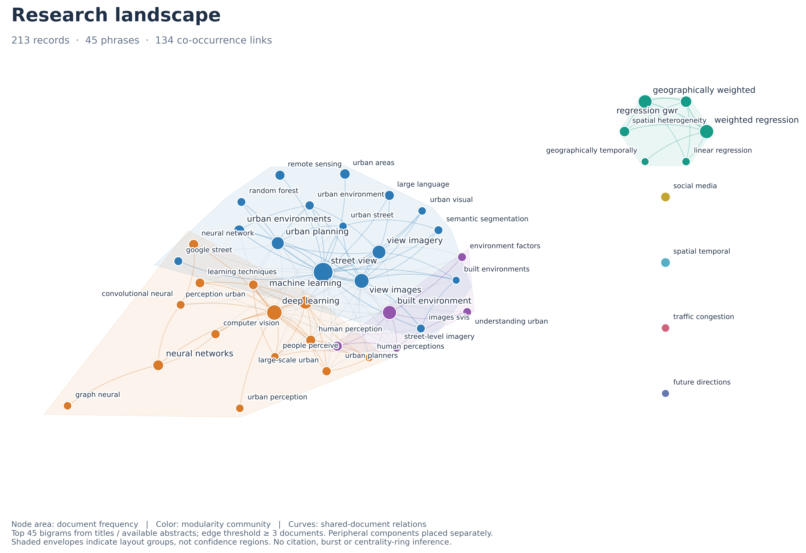
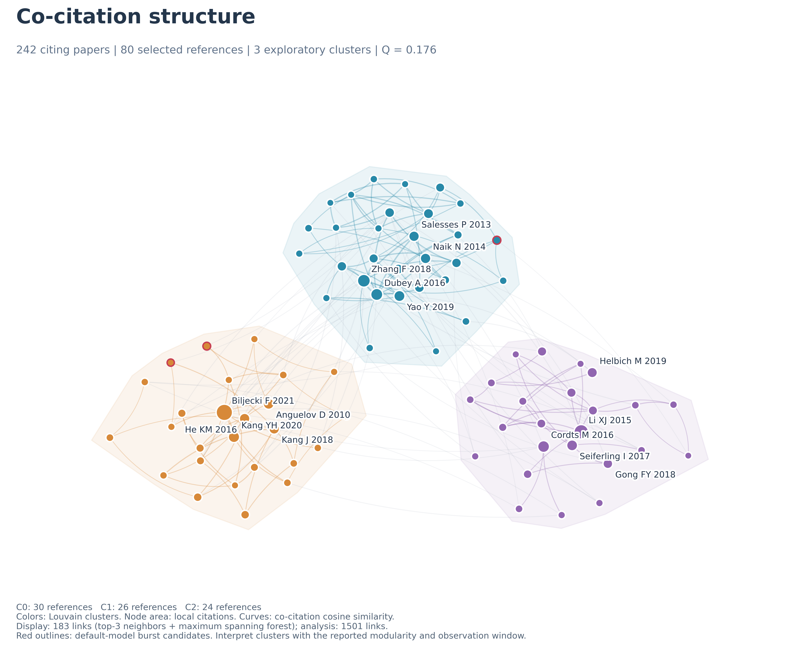
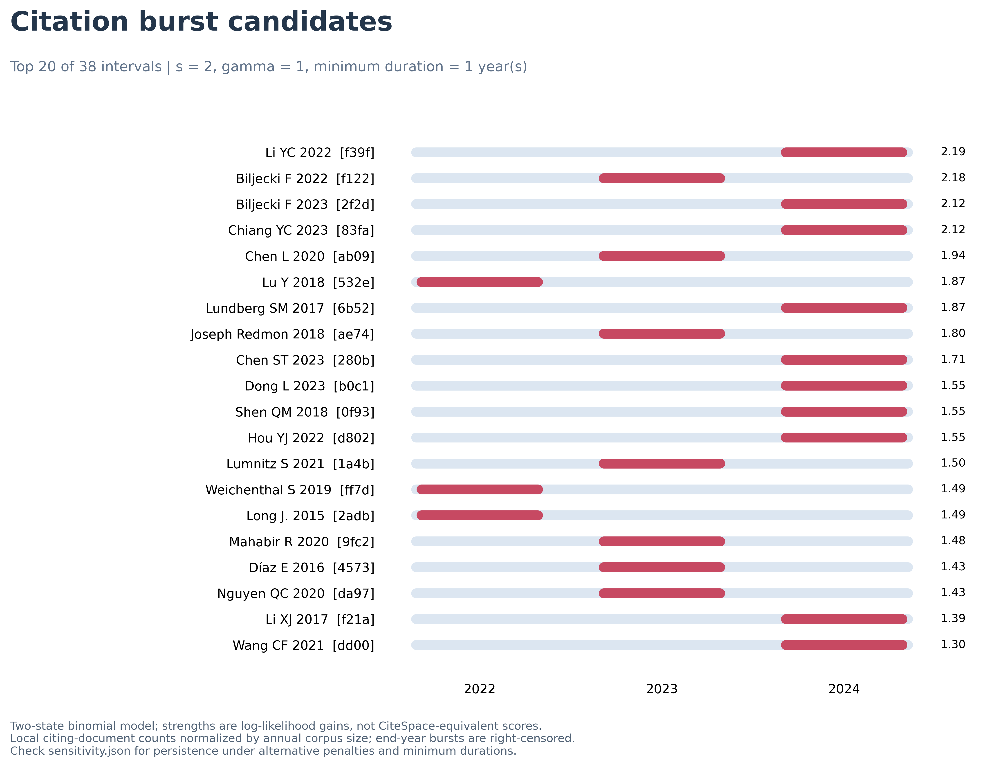
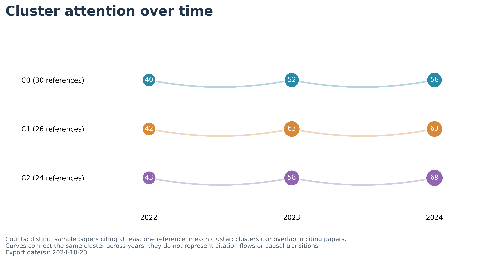

# Literature Research Assistant

**Six modular Codex skills for traceable literature screening, deep reading, structured records, and scientific maps.**

Turn local PDFs, Zotero attachments, and Web of Science exports into a structured review workspace. Choose the workflow that matches your evidence: first-page extraction, title/abstract screening, full-text reading, or citation analysis.

This project combines **AI workflow instructions and local Python/Node tools**. It is not a standalone application or a full CiteSpace replacement. The assistant reads and judges evidence; scripts handle repeatable extraction, statistics, export, and plotting.



*An actual screening result with curved edges and colored communities. Automatically extracted phrases are not author-provided keywords, and phrase co-occurrence is not co-citation.*

## Problems it addresses

- **Mixed source material:** distinguish first pages, abstracts, full papers, library metadata, and citation records.
- **Large collections and context costs:** cache extracted text locally, reuse metadata, and bring selected evidence into model context. No fixed token-saving percentage is claimed.
- **Scattered notes:** preserve source paths, hashes, evidence scope, and page references in structured records and reading notes.
- **Unclear network meaning:** separate collaboration, co-occurrence, co-citation, and burst detection; retain parameters and supporting paper IDs.
- **Overloaded workflows:** load only the requested module. Exporting a table does not silently trigger full-text review; changing a layout does not require rereading the corpus.

## Modules

| Invocation | Use case | Outputs and purpose |
|---|---|---|
| `$literature-pdf-abstract` | First pages and abstract-level reading | Metadata, visible affiliations, original keywords, evidence-linked records and notes |
| `$literature-zotero-screen` | Economical screening of large attachment libraries | Metadata matching, duplicate and missing-data checks, candidate topics for prioritizing reading |
| `$literature-export` | Summarizing existing records | Excel and UTF-8 CSV with sources and evidence scope; no invented findings |
| `$literature-deep-read` | Understanding a specific full paper | Research questions, methods, data, results, limitations, and evidence pages |
| `$literature-wos-analysis` | WoS exports containing cited references | Co-citation clusters, local annual citation counts, bursts, frontier candidates, and sensitivity analysis |
| `$literature-figures` | Plotting existing evidence and analysis | English PNG (450 DPI), SVG, and PDF; supported network types depend on the input |

The router is `$literature-review-map`. Modules can be used independently or combined, for example **WoS analysis → export → figures**.

## Installation

```bash
git clone https://github.com/yandisyn/literature-research-assistant-.git
cd literature-research-assistant-
python -m venv .venv
# Windows PowerShell: .venv\Scripts\Activate.ps1
# macOS / Linux: source .venv/bin/activate
python -m pip install -r requirements.txt
python literature-review-map/scripts/test_wos.py
```

Copy the complete `literature-review-map/` folder into your Codex skills directory, commonly `~/.codex/skills/`, or the skills location configured in your environment. Keep the nested modules together: they share scripts and references. Start a new session if newly installed modules are not visible.

Python 3.11 is recommended. An existing compatible environment can also be used. Dependencies do not include Codex, a language model, OCR language packs, or the optional Excel runtime. XLSX export requires a host-provided Node environment with `@oai/artifact-tool`; this project does not assume that package is publicly installable from npm. CSV works without it. See [usage and setup](docs/USAGE.md).

## Example requests

```text
$literature-pdf-abstract Organize <PDF folder> using first pages and abstracts only. Create reading notes.
$literature-zotero-screen Screen <Zotero storage folder>, prioritizing existing metadata and cached text.
$literature-deep-read Read <paper.pdf> in full and record methods, results, and evidence pages.
$literature-export Export every record in <library.json> to Excel and CSV.
$literature-wos-analysis Analyze <savedrecs.txt> in a new output folder and generate English static figures.
$literature-figures Improve curves, spacing, and labels using the existing data in <analysis folder>.
```

## Example results

### Co-citation structure



A real run used 242 WoS papers published in 2022–2024, yielding 11,329 normalized reference keys. The example selects 80 nodes and 1,501 analysis edges, with three exploratory communities. Only 183 edges are shown for readability. Modularity is approximately 0.176, indicating weak separation.

### Citation burst candidates



Default parameters detected 38 single-year burst intervals; 18 touched the final year. Requiring two years at gamma=1 produced zero intervals, as did gamma=2. **These results support exploratory screening, not a claim of stable research frontiers.**

### Cluster attention over time



Nodes count sample papers citing each cluster in each year. A paper can contribute to multiple clusters. Curves connect observations of the same cluster, not topic migration or causal transitions.

See [methods and results](docs/METHODS-AND-RESULTS.md) for the validation scope and limitations. The figures are actual project outputs. Original papers, Zotero databases, full-text caches, complete WoS exports, and abstract collections are not distributed here.

## Deliverables

- **Records:** JSON, CSV, source and evidence fields, and per-paper Markdown notes.
- **Workbooks:** optional XLSX; the WoS example includes documents, bursts, clusters, selected references, and sensitivity.
- **Analysis:** GraphML, network JSON, annual counts, parameters, quality reports, and frontier candidates.
- **Figures:** static PNG, editable SVG, and vector PDF.

Each request produces only the relevant outputs and necessary prerequisites.

## Limitations

1. Text extraction is not full-text reading; screening is not a systematic review.
2. Author identities, affiliation aliases, reference variants, and OCR require verification.
3. Default batch topic extraction is English-oriented; other or mixed languages need adaptation.
4. WoS total citations are not annual citation histories. Annual local counts are reconstructed from sample publication years and cited references.
5. Burst strengths from the two-state binomial implementation are not guaranteed to match CiteSpace. Frontier candidates require substantive reading.
6. Publication suitability depends on analysis validity and journal specifications, not resolution alone.
7. Source libraries are read-only by default. Use separate output folders for new datasets.
8. End-to-end runs were tested primarily on Windows. macOS/Linux and a fresh dependency installation have not been fully validated. The Windows OCR helper is platform-specific.

## Repository layout

```text
literature-review-map/    Complete installable skill package
  SKILL.md               Router
  skills/                Six modules
  scripts/               Extraction, analysis, validation, and plotting
  references/            Schemas and methods
  agents/                Codex display metadata
docs/                    Usage, methods, release notes, and example figures
requirements.txt         Python dependency ranges
```

## License and contributions

Project code and documentation are available under the [MIT License](LICENSE). Third-party source literature is not redistributed, and its rights are not transferred. See [release notes](docs/RELEASE.md). Report issues with a minimal reproducible example, dependency versions, and redacted logs; do not attach private literature libraries.
